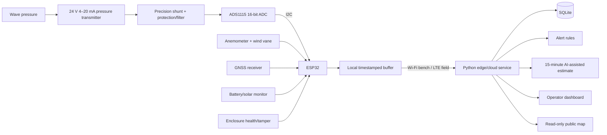

# Project FALCON-01 — System Architecture

Status: software prototype implemented; hardware integration and validation pending. Updated 2026-11-07.

## 1. End-to-end system



The ESP32 performs acquisition and buffering. The service stores records, applies alert logic, serves dashboards, and hosts prediction processing. AI failure must never stop acquisition, storage, alerts, or current readings.

## 2. Power architecture

```text
Six proposed 5 V panels in 3S2P
  → fuse/protection
  → LiFePO4-compatible solar charge controller
  → 12.8 V 8 Ah LiFePO4 battery with BMS
      ├→ regulated low-voltage rails for ESP32, ADC, GPS, and logic
      ├→ sensor-specific rail(s) for wind/GNSS/modem as required
      └→ fused DC–DC boost → 24 V pressure-transmitter loop
```

The 3S2P topology and claimed total wattage are provisional until actual panel Vmp/Voc/Imp/Isc and controller limits are verified. Runtime and 24/7 claims require measured load, conversion efficiency, solar input, and battery tests.

## 3. Pressure channel

### 3.1 Electrical chain

```text
12.8 V battery → fuse → 24 V boost → two-wire transmitter loop
4–20 mA loop → precision shunt resistor → protected voltage
protected voltage → ADS1115 → I²C → ESP32
```

- The transmitter senses pressure; ADS1115 only digitizes the shunt voltage.
- Shunt value must map 4–20 mA into the safe ADS1115 common-mode/input range under all tolerances.
- Add appropriate fuse, reverse-polarity/transient protection, filtering, and a documented grounding/return scheme.
- Never feed 24 V into the ADS1115 or ESP32.

### 3.2 Mechanical placement

The sensor is fixed relative to the seabed or an independent mooring reference with clearance above the bed. It is not fixed 0.5 m below the floating buoy. Site depth, tidal range, cable routing, strain relief, debris exposure, and retrieval must be surveyed before deployment. The purchased 5 m span limits measurable pressure head; it does not require 5 m submergence.

### 3.3 Wave processing

For each validated burst:

1. convert ADC voltage to loop current and calibrated pressure;
2. reject open-loop, short-loop, saturated, timestamp, and spike faults;
3. remove atmospheric/reference offset as applicable, mean, and slow trend;
4. apply windowing and transform the usable band to the frequency domain;
5. solve the linear dispersion relation and calculate the depth-dependent pressure-response factor;
6. correct only bins above the approved response/SNR threshold;
7. obtain the corrected surface-elevation spectrum and spectral wave height;
8. store the estimate with method, depth, calibration, band, and quality metadata.

Proposed sample rate is 4 Hz (2 Hz Nyquist). Final rate/band depend on the transmitter's measured response and reference testing. `ΔP/(ρg)` is the initial hydrostatic conversion, not the complete dynamic correction.

## 4. ESP32 firmware

- Acquire pressure, wind, GPS, power, and health channels.
- Timestamp in UTC, validate ranges, attach units and quality flags.
- Calculate local summaries and threshold persistence/debounce.
- Buffer original records during outages and replay without duplicate timestamps.
- Upload routine summaries at the approved 1–5 minute interval plus validated events.
- Serve only a compact setup/diagnostic portal locally.
- Use watchdog and brownout recovery after they are tested.

## 5. Telemetry contract

Every record should include schema version, station ID, sequence ID, sampling-window start/end, source, UTC timestamp, units, quality flags, calibration state, and communication state. A routine packet carries pressure-derived wave summary, wind, GPS, battery/solar, and health. Raw 4 Hz pressure samples remain in the local buffer or are uploaded only for calibration/testing; they are not continuously transmitted per wave.

## 6. Edge/cloud service

`edge/falcon_edge/` is a Python HTTP service, normally on port `8765`.

| Module | Responsibility |
| --- | --- |
| `service.py` | routes, runtime state, dashboard hosting, scenarios |
| `sources.py` | simulator and ESP32 sources |
| `storage.py` | SQLite schema, migrations, queries |
| `forecast.py` | current deterministic short-horizon baseline/demo |
| `rules.py` | channel validation and deterministic alerts |

Core routes: `/status`, `/wave`, `/gps`, `/battery`, `/solar`, `/ai`, `/logs`, `/api/telemetry/current`, and `/api/scenario`. SQLite stores telemetry, alerts, prediction records, and system events. Runtime databases and telemetry dumps are not committed.

## 7. Prediction architecture

The thesis target is one **15-minute AI-assisted wave-height research estimate**.

```text
validated chronological records
  → feature generation from recent wave history/trend/variability + wind
  → chronological train/validation/test split
  → Python ML regression model
  → compare with persistence and damped-trend baselines
  → MAE, RMSE, mean bias, sample count, failure analysis
  → 15-minute model output with quality/status
```

The existing `forecast.py` implements a transparent damped trend and supports 5/10/15-minute UI demonstrations. It is a baseline, not evidence that the required ML model has been trained. The product must use `COLLECTING` or `UNAVAILABLE` when input history/quality is insufficient.

## 8. Dashboards

### Operator dashboard

`dashboard-next/` is React + TypeScript + Vite, built to `edge/static/dashboard/`. It provides Overview, Sensors, GPS/safety, Alerts/records, settings, detailed quality and calibration states, and maintenance-oriented evidence.

### Public dashboard

`public-dashboard/` is a separate read-only Palawan map for coastal awareness and research observation. It shows available stations, simplified pressure-derived condition, wind, reporting status, and last update. Demo stations are Puerto Princesa, Dumaran, Roxas, and San Vicente. It does not replace PAGASA/local advisories and does not expose operator controls, protected coordinates, raw logs, or security details.

## 9. Deployment modes and failures

| Mode | Transport | Status/purpose |
| --- | --- | --- |
| Simulator | local | Presentation and software testing; always labeled |
| Bench serial | USB/UART | Bring-up and channel diagnostics |
| Bench Wi-Fi | Wi-Fi | Integration and dashboard testing |
| Field trial | LTE/4G | Proposed limited near-shore deployment |

- Link loss: retain last values, mark stale/offline, buffer and retry.
- One missing sensor: mark that channel unavailable; other channels continue.
- Weak pressure response/noisy correction: no wave result; report reason.
- AI unavailable: current measurements and alerts continue.
- Service restart: additive migrations and idempotent replay.

## 10. Security and limitations

Production authentication, hardened TLS, OTA, and multi-tenant access are not complete. Simulator coordinates are demonstration references. The prototype is not a certified navigation, emergency-warning, or official forecasting system.
